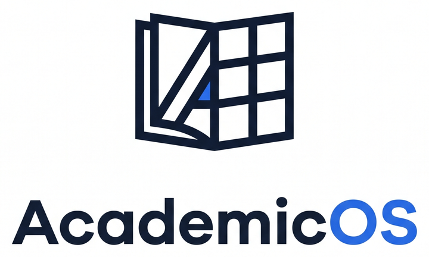

<div align="center">



# AcademicOS

**An operating system for your degree.**

Browse, search, read, watch and listen to an entire semester of study material —
without ever leaving the app. Google Drive stores the files; AcademicOS makes them feel native.

`Web App Created By - Ayush Jha, 2CSE-4`

**Live: [academic-os-eight-rust.vercel.app](https://academic-os-eight-rust.vercel.app)**

</div>

---

## What it does

AcademicOS indexes the master Drive folder **`MATERIALS BY AYUSH JHA, 2CSE-4`** and turns it into a
fast, installable academic workspace.

| Area | Capability |
| --- | --- |
| **Smart Library** | Dual navigation — the original Drive folder tree *and* a parsed Year → Semester → Subject → Type organiser |
| **In-app viewer** | PDF reader (zoom, page jump, fullscreen, night reading), text/markdown reader, image viewer, document fallback |
| **Video** | Reels-style vertical feed with a one-tap landscape *Lecture Mode*, speed 0.75×–2×, playlist |
| **Audio** | Podcast-grade player with waveform scrubber, ±15 s jumps, sleep timer, persistent mini-player |
| **Study AI** | Groq-backed chat (English · हिंदी · Hinglish · 日本語) grounded on the indexed catalog, streaming Markdown + LaTeX |
| **Smart search** | `⌘K` / `Ctrl K` palette with fuzzy, abbreviation-aware matching (COA, DCN, DECO, OOP…) |
| **Workspace** | Favorites, custom collections, recents, downloads and search history — local-first, zero DB cost |
| **PWA** | Installable on desktop + mobile, offline app shell, custom font & icons precached |

## Stack

- **Next.js 15** App Router · **TypeScript** · **Tailwind CSS**
- **pdf.js** for real in-browser PDF rendering
- **Groq** open-weight models: `openai/gpt-oss-120b` → `openai/gpt-oss-20b` → graceful local fallback
- **Google Drive Files API** proxied entirely through server routes
- No database. No paid services. Zero cost by design.

## Architecture

```
src/
├─ app/
│  ├─ page.tsx            Home / Explore
│  ├─ library/            Dual navigation library
│  ├─ ai/                 Streaming Study AI chat
│  ├─ video/              Reels-style lecture feed
│  ├─ audio/              Podcast player + queue
│  ├─ workspace/          Favorites, collections, history
│  ├─ viewer/[id]/        Universal in-app viewer + AI tools
│  ├─ settings/ about/    Preferences & credits
│  └─ api/
│     ├─ catalog/         Indexes Drive (or returns curated snapshot)
│     ├─ chat/            Groq streaming chat + model fallback
│     ├─ ai/              Per-document study tools
│     ├─ drive/           Byte proxy (API key or public link)
│     └─ health/          Integration status
├─ components/            Shell, palette, players, cards, markdown
├─ data/seed-catalog.ts   Curated snapshot of the real folder (67 files)
└─ lib/                   Catalog enrichment, search, AI, local store
```

**Security model:** every key lives in Vercel environment variables and is read only inside
`src/app/api/*` route handlers. The browser never receives `GROQ_API_KEY`, Drive credentials
or Turnstile secrets. `.env*` is git-ignored and `.env.example` is sanitised.

## Getting started

```bash
npm install
cp .env.example .env.local     # optional — the app runs with zero keys
npm run dev                    # http://localhost:3000
```

### Environment variables

All optional. The app is fully usable without them (curated catalog + local AI fallback).

| Variable | Purpose |
| --- | --- |
| `GOOGLE_DRIVE_API_KEY` | Live re-indexing + official media streaming |
| `GOOGLE_DRIVE_ROOT_FOLDER_ID` | Master folder (pre-set to the 2CSE-4 folder) |
| `GROQ_API_KEY` | Enables streaming Study AI and viewer study tools |
| `GROQ_MODEL_PRIMARY` / `GROQ_MODEL_FAST` | Default `openai/gpt-oss-120b` / `openai/gpt-oss-20b` |
| `NEXT_PUBLIC_CLERK_*`, `CLERK_SECRET_KEY` | Optional account sync |
| `NEXT_PUBLIC_TURNSTILE_*`, `TURNSTILE_SECRET_KEY` | Optional bot protection |

## Data flow

1. `/api/catalog` re-indexes the Drive folder when a key is present, otherwise serves the curated
   snapshot in `src/data/seed-catalog.ts` (real file IDs, 67 resources).
2. Each file is enriched client-agnostically: year, semester, subject and resource type are parsed
   from its name and folder path (`src/lib/catalog.ts`).
3. `/api/drive` streams bytes through the app origin, so the viewer, players and downloads never
   open `drive.google.com`.

## Accessibility & design

Swiss/editorial layout with 1px hairlines, deliberate whitespace and a light-first palette;
refined slate dark theme (never pitch black) with system sync. Full keyboard support, visible focus
rings, 44 px touch targets and safe-area padding for notched devices.

## Licence

Personal academic project. Study material remains the property of its respective owners.

<div align="center"><sub>Web App Created By - Ayush Jha, 2CSE-4</sub></div>
